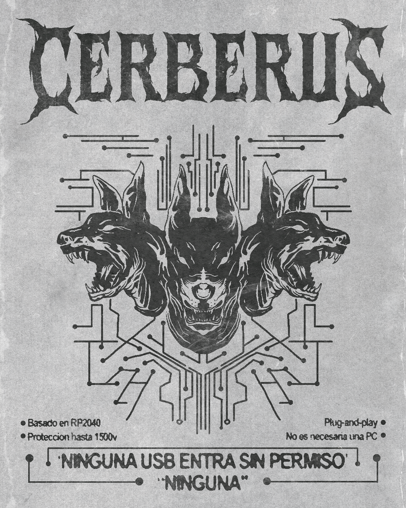

# Cerberus
<p align="center">
  
</p>

<p align="center">
  <strong>Developed by Lab217</strong><br>
  No USB gets in without permission. NONE
</p>

<p align="center">
  <sub>Proudly sponsored by</sub><br>
  <a href="https://www.pcbway.com/"></a>
</p>


[](https://certification.oshwa.org/mx000041.html)

**🌐 [English](README.md) · [Español](README.es.md) · [Português](README.pt.md)**

---

## What is Cerberus?

**Cerberus is a pocket-sized device where you plug in any suspicious USB to see, in real time, what it tries to do to a computer — before you risk your own.**

Instead of blindly trusting a flash drive you found or were handed, you plug it into Cerberus first: the device pretends to be a normal PC, watches how the USB behaves, and instantly warns you if it tries to type on its own (BadUSB / Rubber Ducky), read or write files without permission, or fry the port with a voltage spike (USB Killer). Everything is shown on an OLED screen, a color LED, and over the serial port.

### Key features

- **Detects BadUSB / Rubber Ducky** — spots automated typing that's impossible for a human.
- **Detects USB Killer** — alerts on high-voltage spikes (and blocks them with the optional isolator).
- **Watches reads and writes** — warns if the USB tries to read `AUTORUN`/`README` or write/delete files on its own.
- **Suspicious-device database** — recognizes known attack hardware by its VID/PID.
- **On-device file analyzer** — recursively lists every file on the drive and identifies each one by its **magic bytes** (PNG, PDF, ELF, PE/EXE, ZIP, …), flagging files whose real type doesn't match their extension (e.g. an `.jpg` that is actually an executable). Reads file contents only, never executes.
- **Archive & polyglot inspection** — looks *inside* ZIP archives (via the central directory) for embedded executables/scripts and sweeps files for signatures hidden *after* a valid header (appended payloads / polyglots). Signature-only — nothing is decompressed, so it is immune to zip bombs.
- **Redesigned OLED GUI** — dedicated screens for the home/self-test, mass-storage detection, options menu, USB descriptors, file analyzer, hex viewer, and wipe confirmation, with on-screen `Ok`/`Bak` hints.
- **Full visibility** — OLED screen, NeoPixel LED, and serial console showing everything that happens.
- **Forensics & red team** — captures keystrokes, exports to DuckyScript, and stores info on the last device.
- **Neutralize suspicious drives** — manually wipe the MBR/GPT tables of the mounted USB (from the on-device **Wipe** menu or the `WIPE` serial command); never triggered automatically.

> Built for cybersecurity professionals (SOC, blue team, and red team) as a USB test bench, BadUSB payload debugger, and basic forensic triage tool. Built on top of [USBvalve](https://github.com/cecio/USBvalve).

---

## Installation

### Prerequisites

- Install the Arduino IDE
- `Adafruit TinyUSB Library` version `>=3.6.0`
- `Pico-PIO-USB` version `>=0.7.2`
- Boards `Raspberry Pi RP2040 (4.5.4)` with CPU Speed at `133MHz` and Tools => USB Stack set to `Adafruit TinyUSB`
- `Adafruit_SSD1306` OLED library version `>=2.5.14`
- Raspberry Pi Pico 1 or 2 (or another RP2040-based dev board)
- 128x64 or 128x32 I2C OLED display (SSD1306)

### Steps

---

#### Using the precompiled version

In GitHub, go to Releases and find the most recent `.uf2` file, then download it.

To flash the image:

- Connect the Raspberry Pi Pico with a USB cable while holding the _BOOTSEL/BOOT_ button.
- Release the button.
- A new device named `RPI-RP2` will appear on your system (on Linux you'll probably have to mount it manually).
- Copy the `.uf2` file into the folder, depending on your OLED display.
- Wait a few seconds until the device disappears.

#### Compile your own version

Get the repo locally:

```bash
git clone https://github.com/Glitchboi-sudo/Cerberus-A-USB-Watchdog.git
```

With the Arduino IDE:

- Open `Software/Cerberus/Cerberus.ino`.
- Connect the Raspberry Pi Pico with a USB cable.
- Select the Pico in Arduino.
- Tools -> USB Stack -> Adafruit TinyUSB
- Click `Upload`.

---

## Usage

The idea is simple: **Cerberus sits between your computer and the USB you want to inspect**, acting as a decoy so the suspicious device reveals its real behavior.

### Step by step

1. **Power Cerberus.** Connect it to your computer with a USB cable (the RP2040's native port). On boot, the OLED shows the home screen with "Self-Test:ok" and the LED turns **blue**: ready to go.
2. **Plug the suspicious USB** into Cerberus's host port (not into your computer).
3. **Watch the reaction in real time.** Cerberus pretends to be a PC and lets the device act. The screen, the LED, and the serial console tell you immediately what it's trying to do.
4. **Read the verdict** using the indicator table below: blue = normal, red/orange/magenta = suspicious.
5. **Inspect a storage device.** When a mass-storage drive is attached, the OLED shows a **Mass storage** detection screen; press **Ok** to open the options menu — **Info** (USB descriptors), **Files** (the magic-byte file analyzer), and **Wipe** (neutralize partition tables). In the file analyzer, pick any file to see its detected type, size, and a hex view, plus a warning if it hides an executable/appended payload.
6. **(Optional) Dig deeper over serial** for forensic analysis, keystroke capture, and the `SCAN` / `INSPECT` commands (see below).

### Screen and LED indicators

| Event                       | OLED message       | LED color |
| --------------------------- | ------------------ | --------- |
| Ready/Normal (home)         | "Self-Test:ok"     | Blue      |
| README read                 | "README (R)"       | Blue      |
| AUTORUN read                | "AUTORUN (R)"      | Blue      |
| Write detected              | "WRITING"          | Blue      |
| Delete detected             | "DELETING"         | Blue      |
| HID device connected        | "HID Device"       | Red       |
| HID sending data            | "HID Sending data" | Red       |
| Suspicious device           | "SUSP: [name]"     | Orange    |
| Automated typing (BadUSB)   | "AUTO [X] k/s"     | Magenta   |
| USB Killer detected         | "USB Killer"       | Red       |
| Mass storage detected       | "Mass storage"     | Green     |
| Wipe in progress            | "WIPING DISK"      | —         |
| Wipe complete               | "WIPE DONE"        | —         |
| Wipe error                  | "WIPE ERROR"       | —         |

### Physical buttons

The OLED is driven by four soft-keys. Every screen shows `Ok` / `Bak` hints in the bottom-right; `Up` / `Down` move the selection where a list is shown.

- **Ok** (Accept): open the options menu when a device is attached (on the home screen), enter the highlighted item, toggle hex/ASCII in the hex viewer, and confirm a wipe. On the "No device" screen, any key returns home.
- **Up / Down**: move through menu items and file lists.
- **Bak**: go back one level / exit a menu (disabled on the mass-storage detection screen, which only opens the menu).
- **BOOTSEL**:
  - Short press: reboot the device
  - Press >2 s: show the HID event count

USB descriptor pages and the partition wipe now live inside the on-device **Info** and **Wipe** menu items (no more button-hold shortcuts).

### Serial port commands

Connect over serial (SerialTinyUSB) and type these commands:

| Command    | Description                                |
| ---------- | ------------------------------------------ |
| `HELP`     | Show the list of commands                  |
| `STATUS`   | Current device status                      |
| `LAST`     | Forensic info on the last connected device |
| `RESET`    | Reset counters                             |
| `REBOOT`   | Reboot the device                          |
| `VERBOSE`  | Toggle verbose mode                        |
| `HEXDUMP`  | Toggle hex dump                            |
| `HIDDEBUG` | Toggle HID debug (raw bytes)               |
| `CLEAR`    | Clear info on the last device              |
| `WIPE`     | Neutralize the MBR/GPT tables of the mounted USB |
| `LS [path]`  | List a directory on the USB (`LS /` = volume list; `LS /N` = volume N) |
| `CAT path`   | Preview a file on the USB (text + hex)     |
| `SCAN`       | Recursively list every file with its magic-byte type, size, first bytes, and archive/polyglot warnings |
| `INSPECT path` | Deep look inside one file: ZIP entry listing + 1 MB embedded-signature sweep |
| `BROWSE`     | Open the file analyzer on the OLED         |

> On connecting a terminal, Cerberus prints a banner — wait ~2 s for it. `VERBOSE` is **off by default** (it logs every emulated-disk sector read/write and otherwise floods the console); enable it only to debug disk I/O.

---

## How does it detect threats?

Cerberus doesn't just cut the data lines: **it impersonates a real computer** so the suspicious device reveals its intentions, and it watches four fronts at once.

- **Automated typing (BadUSB / Rubber Ducky).** Cerberus measures the keystroke rate of the emulated keyboard. No human types dozens of keys per second, so when it crosses that threshold it flags an automated attack and shows the detected speed.

- **Malicious reads and writes.** Cerberus exposes a small virtual disk with bait files (`README`, `AUTORUN`). If a USB — or the malware on it — tries to read those files automatically, or write/delete content without your input, it's exposed instantly.

- **Known attack devices.** On connection, Cerberus reads the device identifiers (VID/PID) and compares them against a database of known attack hardware, warning you if it recognizes one.

- **USB Killer.** A hardware circuit monitors the port voltage; on a high-voltage spike it fires an immediate alert. With the galvanic isolator, the discharge is also **physically blocked** so it never reaches your computer.

- **Disguised files on the drive.** Beyond live behavior, Cerberus can read a mounted drive (read-only) and inspect its files without trusting it on a real PC. It identifies each file by its **magic bytes** rather than its extension — so an `invoice.pdf` that is really a Linux/Windows executable is flagged immediately — and it inspects ZIP archives (by their central directory) and sweeps for signatures appended after a valid header, catching executables smuggled inside archives or polyglot files. It is a signature pass only (nothing is run or decompressed), so it is safe even against zip bombs.

Each detection is turned right away into a message on the OLED, an LED color, and a line over the serial port, giving you a clear verdict without having to risk a real machine.

> **On magic-byte inspection:** it reads the *first* bytes of each file and the ZIP index, so it reliably flags extension/type mismatches and named executables inside archives. It does not decompress DEFLATE entries (RAM-constrained MCU), so a payload *compressed* inside an archive is identified by its entry name, not its inner magic bytes.

---

## Hardware

The `Hardware/` folder contains the project's PCB designs.

### Schematic

📄 [Cerberus schematic (PDF)](SCH_Schematic1_2026-06-15.pdf)

### CerberusZero.epro

The complete Cerberus PCB. Includes the integrated circuit with the RP2040, USB connectors, OLED display, and all necessary components.

- **Format**: EasyEDA Pro project
- **How to open**: Import into EasyEDA Pro from `File → Open`

### ADUM3160 USB Isolator

A USB galvanic isolation module based on the ADUM3160 chip. Provides **protection against USB-Killer attacks** by electrically isolating the host from the device, blocking high-voltage spikes.

- **Use**: Optional add-on for an extra layer of physical security
- **Speed**: USB 2.0 Full Speed (12 Mbps)
- **More info**: See `Hardware/ADUM3160 USB Isolator/README.md`

---

## Software Architecture

### Firmware (Cerberus.ino)

The firmware uses both cores of the RP2040:

- **Core 0**: Handles the user interface (OLED, NeoPixel LED, buttons) and emulates a USB storage device to detect suspicious host activity.
- **Core 1**: Runs the USB Host stack via PIO to monitor connected devices (HID, Mass Storage, CDC).

**Main modules:**

- **Threat detection**: USB Killer (via hardware interrupt), suspicious devices (VID/PID database), and automated BadUSB writing (HID speed analysis).
- **MSC emulation**: Virtual RAM disk that detects README/AUTORUN reads and malicious writes.
- **HID processing**: Decoding of keyboard/mouse reports with support for modifiers and special keys.
- **File analyzer**: Read-only, multi-filesystem (FAT/exFAT/NTFS/ext/ISO9660) reader that recursively lists files, types them by magic bytes, and inspects ZIP archives and appended-payload signatures. Exposed on the OLED (**Files** menu) and over serial (`SCAN` / `INSPECT`).
- **OLED interface**: Screen library (`GUI_Base.h`) with dedicated screens — home/self-test, mass-storage detection, options menu, descriptor pages, file list, hex viewer, wipe confirmation, HID/USB-Killer alerts — rendered only from core 0 to avoid cross-core I2C contention.
- **Serial commands**: Text interface for debugging and forensics (HELP, STATUS, LAST, SCAN, INSPECT, WIPE, …).

### Companion App (cerberus_listener.py) — discontinued

> ⚠️ **The desktop companion app is no longer supported and has been removed from the repository.** All monitoring and analysis now happen on-device (OLED) and over the plain serial console (`HELP`, `STATUS`, `LAST`, `SCAN`, `INSPECT`, …), which work with any serial terminal and need no extra software. Earlier versions of the app can still be found in the project's git history, but they are unmaintained and may not reflect the current firmware.

---

## Contributing

This project isn't just a repository: it's an open space to learn, experiment, and build together. **We actively welcome contributions**, whether on the technical side or even the documentation.

- **On hardware:** If you spot opportunities to improve efficiency (for example, using other chips, optimizing power consumption, or swapping components for more reliable alternatives), your suggestions are welcome!
- **On software:** From bug fixes and performance optimization to improvements in code readability or documentation; every contribution, big or small, adds up.
  You don't need to be an expert to help: if you think something can be explained better, that the code can be clearer, or that there's a more elegant way to do something, **tell us or open a Pull Request**.

---

## Credits

- Project based on [USBvalve](https://github.com/cecio/USBvalve) made by _[Cecio](https://github.com/cecio)_
- Galvanic protection based on [USB Isolator](https://github.com/wagiminator/ADuM3160-USB-Isolator) made by _[wagiminator](https://github.com/wagiminator)_
- Partition neutralizer (MBR/GPT table wiping) ported from [USB-Neutralizer](https://github.com/novamostra/USB-Neutralizer) made by _[novamostra](https://github.com/novamostra)_
- Modified / Created by:
  - [Erik Alcantara](https://www.linkedin.com/in/erik-alc%C3%A1ntara-covarrubias-29a97628a/)

---

## Sponsor

<p align="center">
  <a href="https://www.pcbway.com/">
    
  </a>
</p>

<p align="center">
  <strong>This project was made possible thanks to the support of <a href="https://www.pcbway.com/">PCBWay</a></strong>
</p>

We thank **PCBWay** for sponsoring this project. Their high-quality PCB manufacturing service let us take Cerberus from prototype to reality. If you're looking to manufacture your own PCBs with excellent quality, competitive prices, and fast shipping, we recommend visiting [PCBWay](https://www.pcbway.com/).

---

## Open Source Hardware

<p align="center">
  <a href="https://certification.oshwa.org/mx000041.html">
    
  </a>
</p>

Cerberus is **certified open source hardware** by the [Open Source Hardware Association (OSHWA)](https://www.oshwa.org/).

- **Certification UID:** [MX000041](https://certification.oshwa.org/mx000041.html)
- **Country:** Mexico 🇲🇽
- **Hardware · Software · Documentation:** MIT

---

## License

This project is licensed under the **MIT License** — see the [LICENSE](LICENSE) file for details.

Hardware, software, and documentation are all released under MIT, matching the licenses declared in the project's [OSHWA certification (MX000041)](https://certification.oshwa.org/mx000041.html).
